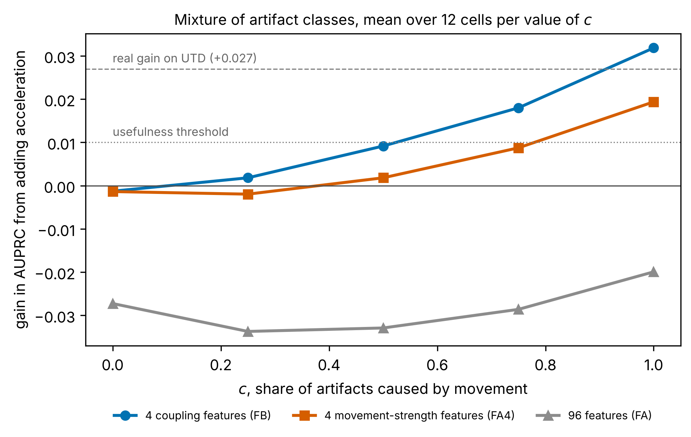

# edasynth

[](https://github.com/cbrg0/edasynth/actions/workflows/ci.yml) [](LICENSE) [](pyproject.toml) [](https://colab.research.google.com/github/cbrg0/edasynth/blob/main/notebooks/quickstart.ipynb)

**Can the accelerometer of a wristband tell which disturbances in a skin-conductance
recording were caused by movement?**

## The aim of the project and the place of this repository

Electrodermal activity (EDA) is the change in the electrical conductance of the skin
that sweat glands produce. Psychology and medicine use it to follow emotional arousal
and stress. Wristbands can record it in daily life, but outside the laboratory the
signal changes for three different reasons: an emotional reaction, sweating that cools
the body in heat or during physical effort, and a disturbance of the contact between
the skin and the electrodes, called an artifact. The long-term aim of the author is an
algorithm that tells these three sources apart with the help of other sensors in the
same device, such as an accelerometer, a skin thermometer or a heart-rate sensor. These
sensors act as witnesses: each of them records something that one of the sources
leaves behind.

This repository is the first stage of that aim. It studies one witness, the
accelerometer, and one source, the artifact. Thermoregulatory sweating, physical effort
and the other sensors need a laboratory experiment, which is the next stage.

## Why the question is open

Zhang et al. (2017) published wristband recordings of 20 people (the UTD data set) in
which three experts marked the artifacts. On these recordings a detector that sees EDA
and acceleration finds artifacts only slightly better than a detector that sees EDA
alone. The quality of a detector is measured here by AUPRC, a score between 0 and 1
that shows how well it ranks true artifacts above clean parts of the signal; guessing
scores 0.038 on these data. The score rises from 0.449 to 0.475, and the 95 %
confidence interval of the difference, from −0.002 to +0.058, includes zero. The real
data therefore cannot say whether the accelerometer helps. They also cannot say why,
because nobody recorded which of the marked artifacts movement actually caused.

## What was done

1. **Measurements on real recordings.** The program measured on the UTD recordings
   how real EDA behaves (its slow level, its fast responses and its noise), how the
   people moved, and how each expert-marked artifact develops over time.
2. **A computer model of wristband recordings.** The model assembles new recordings
   from real material: the physiology of one real person, the movements of another
   person, and artifacts that copy the measured ones. Because the model inserts every
   artifact itself, it knows which artifacts movement caused. The main unknown is
   called *c*, the share of artifacts that movement causes.
3. **300 scenarios.** A scenario is one combination of assumptions about the link
   between movement and artifacts: the value of *c* (0, 0.25, 0.5, 0.75 or 1), how
   strongly a larger movement produces a larger artifact, how long an artifact can lag
   behind its movement (up to 1, 5 or 10 seconds), how often genuine EDA responses
   happen during movement, and the kind of artifact (peaks, drops, level shifts, loss
   of signal or saturation, or a mixture of all four). In some scenarios the assumptions make no
   difference to the result, for example the lag when *c* = 0, so 226 scenarios had to
   be computed. Each was simulated 50 times with 20 new simulated people, because a
   single run can look good or bad by chance. That gives 11 300 runs. In each run the
   program trained a detector on EDA alone and detectors that also see acceleration
   features, and recorded the gain in AUPRC.
4. **Checks that the model is realistic.** A model is useful only if its recordings
   resemble real ones, so this was checked before the scenarios were run. In the main
   check a classifier tries to tell real five-second windows from simulated ones. A
   result of 0.5 (AUC) means that it cannot tell them apart, and 1 means that it always
   can; the limit fixed in advance was 0.70. Further checks confirmed that the model
   recovers physiology that was put into it, that it shows no gain when no link
   between movement and artifacts exists, that it finds a link that was built in, and
   that the features used here reproduce the published result on real data.
5. **Checks on data the model never saw.** The model was compared with EDABE
   (Llanes-Jurado et al., 2023), 43 recordings from another device marked by other
   experts, and run with the movements of another wristband from WESAD (Schmidt et
   al., 2018). These checks test whether the model describes wristband recordings in
   general or only the UTD recordings it was built from.

## What was found



The accelerometer never helps in the scenarios where movement causes less than half of
the artifacts. When movement causes all of them, four coupling features, which ask
whether EDA changes right after a movement, raise AUPRC by 0.032. These four features
are useful in 121 of the 300 scenarios, four features of movement strength in 65, and
the set of 96 acceleration features of Zhang et al. (2017) in only 2. When the artifact
is a loss of signal, EDA alone finds it, and acceleration only adds false alarms.

The model passed the checks on independent data. A classifier separated EDABE
artifacts from simulated ones with a median AUC of 0.68 and clean windows with 0.55,
both under the limit of 0.70. A detector trained only on simulated data found EDABE
artifacts as well as a detector trained on the real UTD recordings (AUPRC 0.556
against 0.537). With WESAD movements the coupling features were useful in the same
three tested scenarios as with UTD movements.

The value of the accelerometer therefore depends on a quantity that no public data set
contains. The next stage is a laboratory experiment that records the cause of each
disturbance, and with the effects found here it needs about 15 to 20 participants.
Every number and its limits are in [docs/RESULTS.md](docs/RESULTS.md).

## How the results were protected from wishful thinking

With 300 scenarios some numbers look interesting by chance, and an author can be
tempted to change the rules after seeing them. To prevent this, the configuration, the
code and the decision rules were fixed before the main results existed, and each
fixed version was published as a dated git tag (`prereg-synth-v1` to `v3`, 25 to 28
October 2026). When a check of the model failed, the model was corrected and all
checks were run again; a limit was never changed to make a check pass. One complete
run of the scenarios (version 1.3.0) was withdrawn after an error was found in it.
[docs/PREREGISTRATION.md](docs/PREREGISTRATION.md) lists every change with its reason.

## How the computations were run and where the figures come from

All results come from the Python program in `src/edasynth/`, started with commands in
a terminal, for example `python -m edasynth grid --source utd`. No other software was
needed; an editor such as VS Code or a notebook such as Jupyter can be used to read the
code and the tables.

| Step | Computer | Dates (2026) |
|---|---|---|
| Real-data result, measurements, checks of the model, pilot | author's MacBook Air and a Linux cloud computer | 23 to 28 October |
| The 11 300 scenario runs (version 1.4.0) | author's MacBook Air, about two days | 28 to 30 October |
| Variants, label noise, analysis, power, figures, checks on EDABE and WESAD | Linux cloud computer | 30 and 31 October |

Every run writes its random seed and the program version into its row of
`results/grid-metrics-utd.csv`, so any run can be repeated. One run repeated on Linux
after the code had been shortened gave the value computed on the Mac to the last digit.

Every figure in `figures/` is drawn by the program (`python -m edasynth figures`, code
in `src/edasynth/figures.py`) from the tables in `results/`; no figure was drawn by
hand. The figure in the section on findings, F0, can be redrawn from the table in the
Colab notebook.

## Reproducing the results

The Colab notebook (button at the top) runs in the browser in about 15 minutes. It
recomputes the scenario summary and draws F0 from the table of 11 300 runs, prints all
checks, downloads the public data and repeats the real-data result, and runs the unit
tests. On your own computer (Python 3.11 or newer, about 200 MB of disk):

```bash
git clone https://github.com/cbrg0/edasynth.git && cd edasynth
pip install -e ".[dev]"
make test       # unit tests, about 2 minutes
make data       # downloads the public data and checks their checksums
python -m edasynth realdata --stored   # the real-data result, about 10 minutes
make help       # every other step; the full set of scenarios takes 1 to 2 days
```

## Contents of the repository

The method with every formula and the source of every parameter is in
[docs/METHOD.md](docs/METHOD.md), the results in [docs/RESULTS.md](docs/RESULTS.md),
the fixed rules in [docs/PREREGISTRATION.md](docs/PREREGISTRATION.md) and the
literature in [docs/REFERENCES.md](docs/REFERENCES.md). The code is in
`src/edasynth/`, with one module per step, and the unit tests are in `tests/`. Every
number that can change a result is in `configs/default.yaml`. The scripts for
downloading the data and for the checks on EDABE and WESAD are in `scripts/`. A
Russian overview is in [docs/README-RU.md](docs/README-RU.md).

## Authorship

The research question, the design decisions, the validation criteria and the
interpretation are by Nuray Doskaliyeva. The code was written with the help of an AI
assistant (Claude) and run and checked by the author.

## Licence and data

The code is under the MIT licence ([LICENSE](LICENSE)); please cite it with
[CITATION.cff](CITATION.cff). The data are not copied into the repository and are
downloaded from their sources: PhysioNet `noneeg` (ODC-By 1.0; Birjandtalab et al.,
2016, 2017), the labels of Zhang et al. (2017, BSD licence), EDABE (Llanes-Jurado et al.,
2023) and WESAD (Schmidt et al., 2018).
