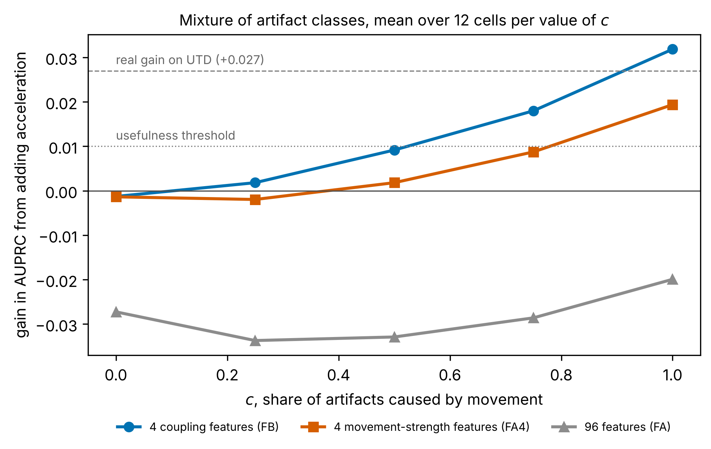

# edasynth: описание на русском

**Может ли акселерометр браслета помочь распознать артефакты электродермальной
активности, вызванные движением?**

## О проекте

Электродермальной активностью называют изменения электропроводности кожи, которые
вызывает работа потовых желёз. По этому сигналу судят об эмоциональном возбуждении и
стрессе. Браслеты позволяют записывать его в повседневной жизни, однако там сигнал
меняется по трём причинам: из-за эмоциональной реакции, из-за потоотделения, которым
тело охлаждается, и из-за плохого контакта кожи с электродами. Изменения последнего
рода называют артефактами. Долгосрочная цель проекта состоит в том, чтобы создать
алгоритм, который различал бы эти источники с помощью других датчиков браслета,
например акселерометра или датчика пульса.

В этом репозитории сделан первый шаг: здесь выясняется, помогает ли акселерометр
находить артефакты и при каких условиях.

## Результат

На открытых записях 20 человек, в которых артефакты отметили эксперты (Zhang et al.,
2017), ускорение улучшает поиск артефактов так слабо, что улучшения может и не быть.
Объяснить это по реальным записям нельзя, потому что никто не фиксировал, какие
артефакты вызвало движение. Поэтому из реальных данных была построена компьютерная
модель записей браслета, в которой причина каждого артефакта известна.

По вертикальной оси рисунка отложено, насколько улучшается поиск артефактов после
добавления ускорения, а по горизонтальной оси отложена доля артефактов, вызванных
движением. Если движение вызывает меньше половины артефактов, акселерометр бесполезен.
Если же движением вызваны все артефакты, полезнее всего оказываются четыре признака,
которые проверяют, меняется ли сигнал кожи сразу после движения. Набор из 96 признаков
ускорения, применявшийся в прежних работах, на рисунке ухудшает результат и помогает
лишь в 2 сценариях из 300. Таким образом, польза акселерометра зависит от доли, которой
нет ни в одном открытом наборе данных, и следующим шагом должен стать лабораторный
эксперимент, в котором эту долю измерят.

## Как это сделано

1. По реальным записям измерили, как ведёт себя сигнал кожи, как двигаются люди и как
   выглядят настоящие артефакты.
2. На основе этих измерений модель собирает новые записи. Артефакты она вставляет
   сама, поэтому знает их причину.
3. Перед основными расчётами модель проверили. Классификатор отличал её записи от
   настоящих лишь слабо, в пределах заранее установленной границы. Кроме того, модель
   проверили на записях другого прибора (EDABE) и на движениях другого браслета
   (WESAD), которых она раньше не видела.
4. Модель прогнали в 300 сценариях, которые различаются тем, как связаны движение и
   артефакты. Каждый сценарий повторили 50 раз, чтобы исход не зависел от случайности.

Правила анализа были зафиксированы и опубликованы до того, как появились основные
результаты. Все числа и границы их применимости приведены в [RESULTS.md](RESULTS.md)
(на английском языке).

## Что где лежит

| Папка или файл | Что в ней находится |
|---|---|
| `docs/METHOD.md` | метод по шагам и источник каждого числа |
| `docs/RESULTS.md` | все результаты и то, чего они не показывают |
| `docs/PREREGISTRATION.md` | правила, зафиксированные до результатов, и все последующие изменения с причинами |
| `docs/REFERENCES.md` | список литературы |
| `figures/` | рисунки |
| `results/` | таблицы результатов, по которым построены рисунки |
| `notebooks/` | блокнот, который повторяет главные результаты в браузере |
| `src/edasynth/` | сама программа |
| `tests/` | автоматические проверки программы |
| `scripts/` | программы для загрузки данных и подготовки EDABE и WESAD |
| `configs/` | все настройки, от которых может зависеть результат |
| `data/` | откуда берутся данные; сами данные скачиваются отдельно |
| остальные файлы главной папки | служебные файлы для установки, цитирования и лицензии |

## Как запустить

Проще всего нажать кнопку **Open in Colab** в начале страницы. Блокнот откроется в
браузере, устанавливать ничего не придётся, а на весь расчёт уйдёт около 15 минут.
Порядок запуска на собственном компьютере описан в [английской версии этой страницы](../README.md#running-it).

## Авторство и лицензия

Исследовательский вопрос, план исследования, критерии проверок и интерпретация
результатов принадлежат Нурай Доскалиевой. Код написан с помощью ИИ-ассистента
(Claude), запущен и проверен автором. Код распространяется по лицензии MIT.
