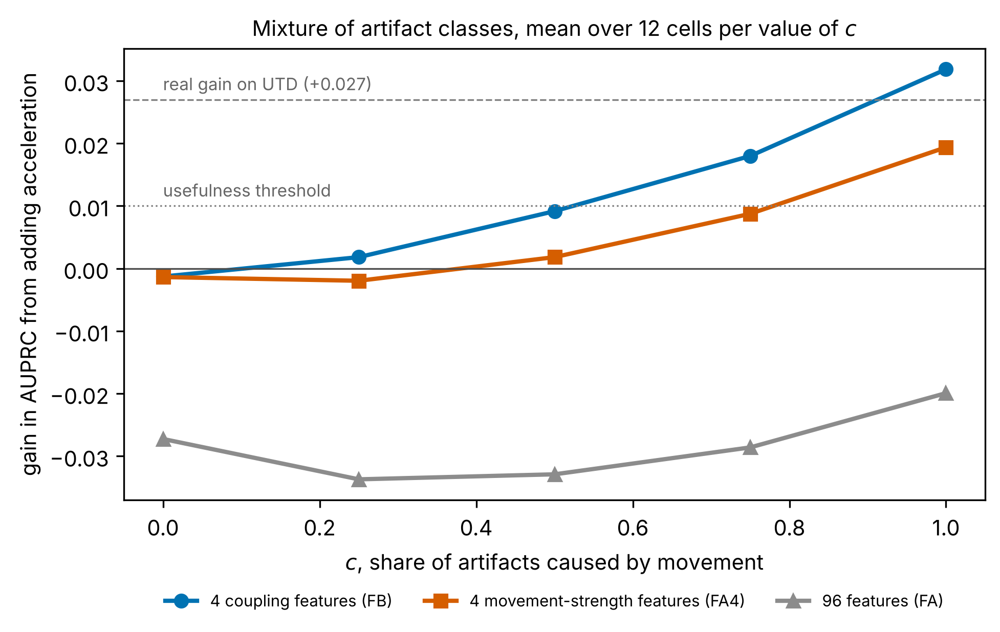

# edasynth: описание на русском

**Может ли акселерометр браслета помочь распознать артефакты электродермальной
активности, вызванные движением?**

## Предпосылки и цель

Электродермальной активностью называют изменения электропроводности кожи, которые
вызывает работа потовых желёз. По этому сигналу судят об эмоциональном возбуждении и
стрессе. Браслеты позволяют записывать его в повседневной жизни, однако там сигнал
меняется по трём причинам: из-за эмоциональной реакции, из-за потоотделения, которым
тело охлаждается, и из-за плохого контакта кожи с электродами. Изменения последнего
рода называют артефактами. Долгосрочная цель проекта состоит в том, чтобы создать
алгоритм, который различал бы эти источники с помощью других датчиков браслета,
например акселерометра или датчика пульса.

В этом репозитории сделан первый шаг: здесь выясняется, помогает ли акселерометр
находить артефакты и при каких условиях.

## Результаты

Zhang et al. (2017) опубликовали записи 20 человек, в которых эксперты отметили
артефакты. Детектор, который кроме сигнала кожи видит и ускорение, находит на этих
записях артефакты лишь немного лучше детектора, который видит только сигнал кожи.
Разница так мала, что её может и вовсе не быть.
Объяснить это по самим записям нельзя, потому что никто не фиксировал, какие
артефакты вызвало движение. Поэтому из реальных данных была построена компьютерная
модель записей браслета, в которой причина каждого артефакта известна.

По вертикальной оси рисунка отложено, насколько улучшается поиск артефактов после
добавления ускорения, а по горизонтальной оси отложена доля артефактов, вызванных
движением. Подписи на рисунке сделаны на английском языке. Если движение вызывает
меньше половины артефактов, акселерометр бесполезен. Если же движением вызваны все
артефакты, полезнее всего оказываются четыре признака, которые проверяют, меняется ли
сигнал кожи сразу после движения. Набор из 96 признаков ускорения, которым пользовались
в прежних работах, на рисунке ухудшает результат и помогает лишь в 2 сценариях из 300.
Таким образом, польза акселерометра зависит от доли, которой нет ни в одном открытом
наборе данных, и следующим шагом должен стать лабораторный эксперимент, в котором эту
долю измерят.

## Методология и валидация

1. По реальным записям измерили, как ведёт себя сигнал кожи, как двигаются люди и как
   выглядят настоящие артефакты.
2. На основе этих измерений модель собирает новые записи. Артефакты она вставляет
   сама, поэтому знает их причину.
3. Перед основными расчётами модель проверили. Классификатор отличал её записи от
   настоящих лишь слабо и не вышел за границу, установленную заранее. Кроме того,
   модель проверили на записях другого прибора из набора данных EDABE и на движениях
   другого браслета из набора данных WESAD; ни те, ни другие она раньше не видела.
4. Модель прогнали в 300 сценариях, которые различаются тем, как связаны движение и
   артефакты. Каждый сценарий повторили 50 раз, чтобы исход не зависел от случайности.

Правила анализа были зафиксированы и опубликованы до того, как появились основные
результаты. Все числа и границы их применимости приведены в файле
[RESULTS.md](RESULTS.md), который написан на английском языке.

## Структура репозитория

| Папка или файл | Что в ней находится |
|---|---|
| `study-description/METHOD.md` | Метод по шагам с указанием источника каждого числа. |
| `study-description/RESULTS.md` | Все результаты и то, чего они не показывают. |
| `study-description/PREREGISTRATION.md` | Правила, зафиксированные до получения результатов, и все последующие изменения с причинами. |
| `study-description/REFERENCES.md` | Список литературы с пояснением, для чего нужен каждый источник. |
| `result-figures/` | Рисунки исследования. |
| `result-tables/` | Таблицы со всеми результатами, по которым программа строит рисунки. |
| `run-in-browser/` | Блокнот, который повторяет главные результаты в браузере. |
| `program-code/edasynth/` | Программа, которая проводит исследование. |
| `program-tests/` | Автоматические тесты, которые проверяют программу. |
| `data-download-and-external-checks/` | Программы, которые скачивают данные и проводят проверки на EDABE и WESAD. |
| `settings/` | Файл настроек, в котором собраны все числа, способные повлиять на результат. |
| `downloaded-data/` | Сюда скачиваются данные; описание в этой папке объясняет, откуда они берутся. |
| остальные файлы главной папки | Служебные файлы, нужные для установки программы, её цитирования и указания лицензии. |

## Воспроизведение результатов

Проще всего нажать кнопку **Open in Colab** в начале страницы. Блокнот откроется на
бесплатных компьютерах Google, поэтому устанавливать ничего не придётся. Чтобы
запустить его, нужно выбрать в меню *Runtime*, а затем *Run all*. Первая часть
блокнота меньше чем за минуту заново строит главный рисунок и выводит результаты всех
проверок по таблицам из репозитория. Вторая часть скачивает открытые записи и
повторяет на них сравнение детекторов, на это уходит около десяти минут. Третья часть
примерно за две минуты запускает автоматические тесты. Время указано приблизительно,
потому что оно зависит от скорости компьютера и интернета. Полный расчёт всех 300
сценариев в блокнот не входит, так как на ноутбуке он занимает одни-двое суток; его
результаты хранятся в папке `result-tables/`, и первая часть блокнота работает с ними.

Порядок запуска на собственном компьютере описан в
[английской версии этой страницы](../README.md#reproducing-the-results).

## Авторство и лицензия

Исследовательский вопрос, план исследования, критерии проверок и интерпретация
результатов принадлежат Нурай Доскалиевой. Код написан с помощью ИИ-ассистента
(Claude), запущен и проверен автором. Код распространяется по лицензии MIT.
